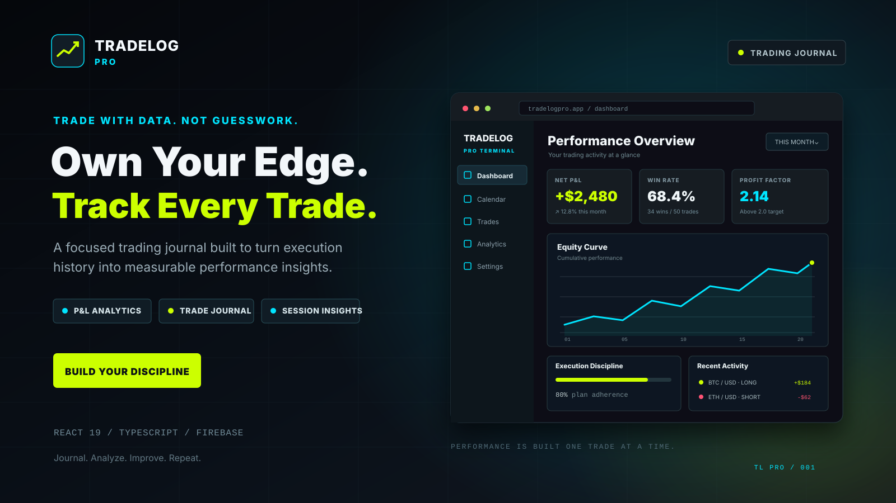
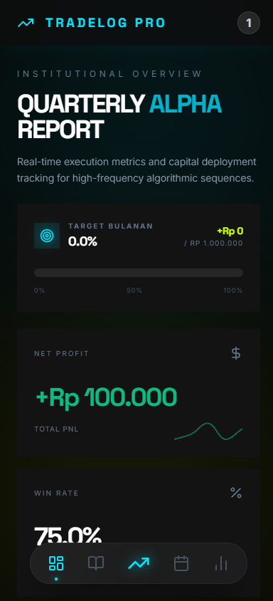
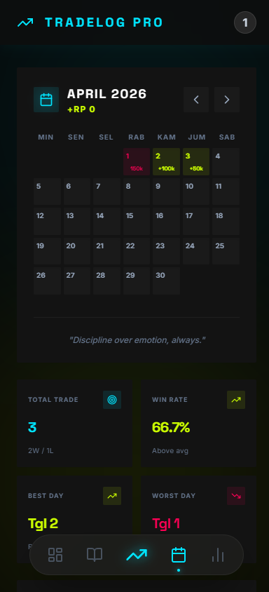
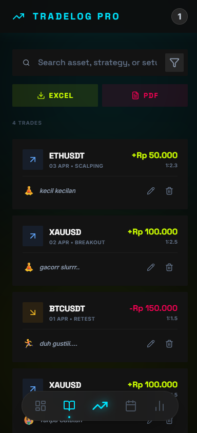
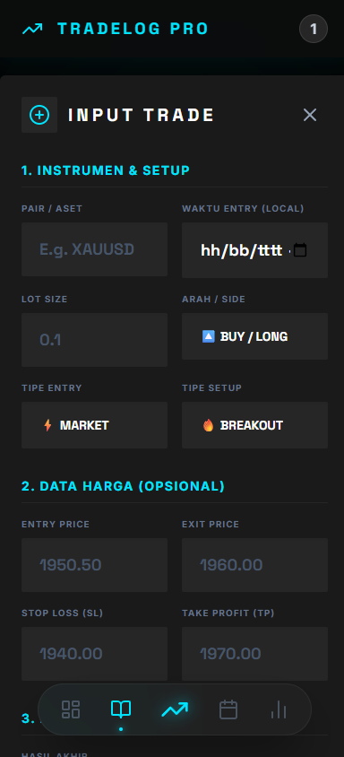
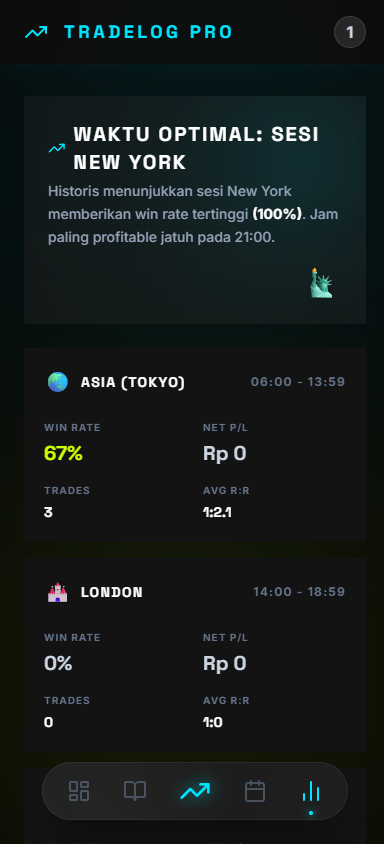

<!-- TradeLogPro promotional README -->
<p align="center">
  
</p>

<h1 align="center">TradeLogPro</h1>

<p align="center">
  <strong>A focused trading journal to measure performance, strengthen discipline, and understand your trading behaviour.</strong>
</p>

<p align="center">
  
  
  
  
  
</p>

<p align="center">
  <a href="#overview">Overview</a> ·
  <a href="#features">Features</a> ·
  <a href="#screenshots">Screenshots</a> ·
  <a href="#installation">Installation</a> ·
  <a href="#tech-stack">Tech Stack</a>
</p>

---

## Overview

**TradeLogPro** is a trading journal application built to help traders review decisions with structured data instead of relying on memory. Record trades, monitor performance, review trading sessions, and export reports from a single dark interface.

The application follows the **Institutional Ghost** visual direction: a restrained dark palette, tonal surfaces, precision typography, and carefully placed cyan and lime accents.

> TradeLogPro is a journaling and performance-review tool. It does not provide investment advice or guarantee trading results.

## Features

### Performance dashboard
- Track net P&L, win rate, profit factor, and total trades.
- Review capital growth through an equity-curve chart.
- Compare win, loss, and break-even distributions.
- Monitor monthly targets and progress.
- Use embedded trend indicators for quick performance context.

### Trading calendar
- View daily profit and loss on a monthly heatmap.
- Review monthly trade count, win rate, best day, and worst day.
- Track current winning or losing streaks.
- Inspect daily P&L with chart tooltips.
- Access recent trades directly from the calendar view.

### Trade journal
- Record asset, setup, long/short direction, entry and exit prices, lot size, risk-to-reward ratio, and P&L.
- Complete a discipline checklist for setup and risk confirmation.
- Track the emotional context of each trade, including calm, patient, greedy, fear, and FOMO.
- Search trade records and filter by outcome, setup, or direction.
- Open a detailed view for an individual trade.
- Export records to Excel (.xlsx) and PDF.

### Session analysis
- Review performance by trading hour.
- Use time-based analysis to identify patterns in trading activity.

### Account and preferences
- Register and sign in with Firebase Authentication.
- Select a preferred display currency: IDR, USD, EUR, or JPY.
- Configure monthly profit targets.
- Sign out from the settings area.

## Screenshots

<p align="center">
  <strong>Dashboard &amp; Performance Overview</strong><br>
  
</p>

| Trading Calendar | Trade History |
|:---:|:---:|
|  |  |

| Trade Entry | Session Analysis |
|:---:|:---:|
|  |  |

## Tech Stack

| Area | Technology |
|---|---|
| UI framework | React 19 |
| Language | TypeScript |
| Build tool | Vite 7 |
| Styling | Tailwind CSS 3.4 |
| Icons | Lucide React |
| Charts | Chart.js, react-chartjs-2 |
| Backend services | Firebase 11 |
| Authentication | Firebase Authentication |
| Database | Cloud Firestore |
| PDF export | jsPDF, jspdf-autotable |
| Spreadsheet export | SheetJS (xlsx) |
| Date utilities | date-fns |

## Design System — Institutional Ghost

The interface uses a high-contrast dark palette designed to keep performance data readable and reduce visual clutter.

| Token | Value | Purpose |
|---|---|---|
| Background | `#050505` | Primary application background |
| Surface | `#0e0e0e` | Base card surface |
| Surface container low | `#131313` | Elevated panels |
| Surface container | `#1a1a1a` | Secondary containers |
| Surface container highest | `#262626` | Inputs and hover states |
| Primary | `#00E5FF` | Cyan accent and primary actions |
| Success | `#CCFF00` | Positive performance states |
| Danger | `#FF0055` | Negative performance states |

**Typography:** Space Grotesk for headlines, Inter for interface text, and JetBrains Mono for numerical or data-oriented content.

**Design principles:** tonal surface separation instead of heavy borders, compact geometry, restrained neon accents, and glass-like overlays where appropriate.

## Installation

### Requirements

- [Node.js](https://nodejs.org/) v18 or newer.
- npm (included with Node.js).
- A Firebase project with **Authentication** and **Cloud Firestore** enabled.

### 1. Clone the repository

```bash
git clone https://github.com/Dzakiudin/tradelogpro.git
cd tradelogpro
```

### 2. Install dependencies

```bash
npm install
```

### 3. Configure Firebase

Create a `.env` file in the project root and provide the Firebase web app configuration:

```env
VITE_FIREBASE_API_KEY=your_api_key
VITE_FIREBASE_AUTH_DOMAIN=your_project.firebaseapp.com
VITE_FIREBASE_PROJECT_ID=your_project_id
VITE_FIREBASE_STORAGE_BUCKET=your_storage_bucket
VITE_FIREBASE_MESSAGING_SENDER_ID=your_sender_id
VITE_FIREBASE_APP_ID=your_app_id
```

Use the configuration for your own Firebase project. Do not commit private credentials, service-account files, or other secrets.

### 4. Start the development server

```bash
npm run dev
```

Vite will print the local development URL in the terminal (commonly `http://localhost:5173`).

## Available Scripts

| Command | Description |
|---|---|
| `npm run dev` | Start the Vite development server. |
| `npm run build` | Run TypeScript project builds and create the production bundle. |
| `npm run preview` | Preview the production build locally. |
| `npm run lint` | Run ESLint. |

## Project Structure

```text
tradelogpro/
├── screenshots/             # Application screenshots and promotional artwork
├── src/
│   ├── components/
│   │   ├── Analytics/       # Time-based trading analysis
│   │   ├── Auth/            # Login and registration
│   │   ├── Calendar/        # Trading calendar and monthly summaries
│   │   ├── Charts/          # Performance charts
│   │   ├── Common/          # Shared UI components
│   │   ├── Dashboard/       # Dashboard cards and target progress
│   │   ├── Layout/          # Navigation and application layout
│   │   ├── Settings/        # User preferences and account settings
│   │   └── Trades/          # Trade list, form, and detail views
│   ├── context/             # React context, including authentication
│   ├── lib/                 # Firebase initialization
│   ├── types/               # TypeScript interfaces
│   └── utils/               # Formatting and export helpers
├── index.html
├── package.json
├── tailwind.config.js
├── tsconfig.json
└── vite.config.ts
```

## Data, Privacy & Security Notes

- Firebase Authentication is used for account sign-in and registration.
- Trade data is stored using Cloud Firestore.
- Configure Firestore Security Rules so each authenticated user can access only the records they are authorized to use.
- Keep local environment files and sensitive project credentials out of version control.
- Review Firebase usage, quotas, and access settings before deploying the application publicly.

## Contributing

Contributions, bug reports, and improvement suggestions are welcome. Open an issue to discuss a change, or submit a pull request with a clear description of the proposed update.

## License

This project is licensed under the **MIT License**. See [LICENSE](LICENSE) for details.

---

<p align="center">
  <strong>TradeLogPro</strong><br>
  <em>Journal. Analyze. Improve. Repeat.</em><br><br>
  Made with care by <a href="https://github.com/Dzakiudin">Dzakiudin</a>
</p>
